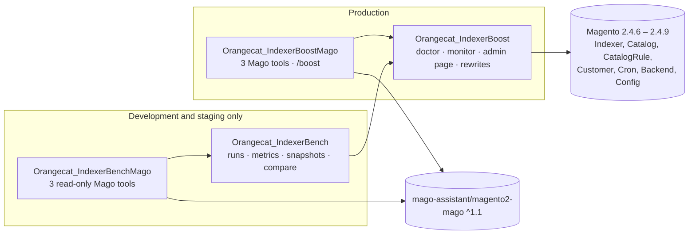
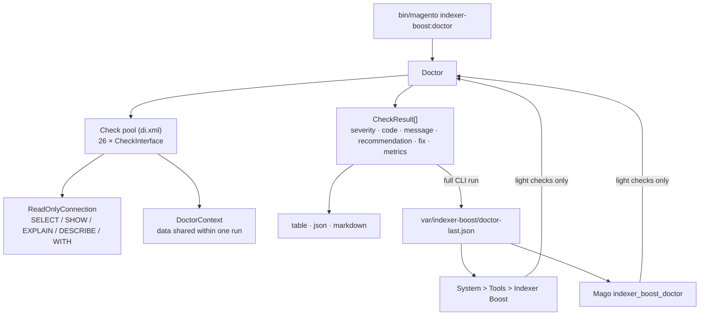
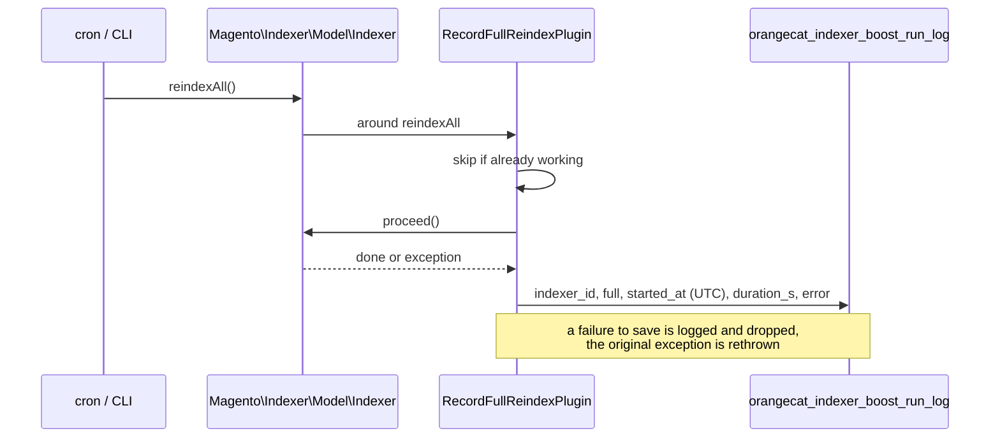
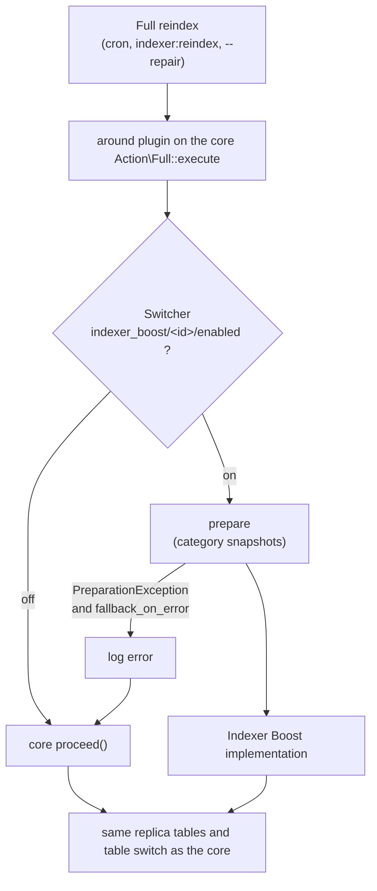
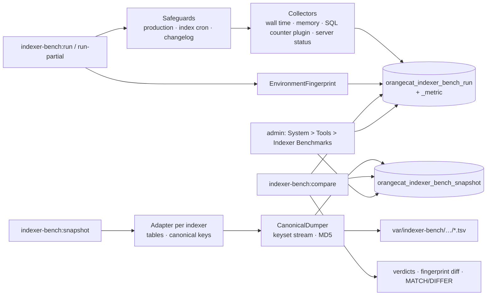
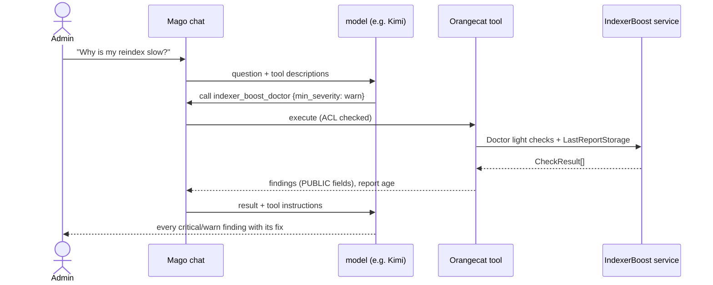

# Indexer Boost — architecture

How the four modules are built, how data flows between them and which guarantees each part gives. Decisions are
recorded as ADRs next to the code (`<module>/docs/decisions/`); this document links them where they apply.

## Modules and dependencies



- `Orangecat_IndexerBoost` depends only on core modules. The production modules contain no third-party code.
- `Orangecat_IndexerBench` reuses the doctor's read-only connection and its catalog and database providers for the
  environment fingerprint. `mage-os/module-profiler` is suggested for `--profile`, never required.
- The Mago add-ons are the only modules that depend on Mago. They contain no logic of their own beyond shaping
  results for the model: every answer comes from the same services the CLI uses.

## Orangecat_IndexerBoost

```
IndexerBoost/
├── Console/Command/      DoctorCommand, ToggleCommand
├── Controller/Adminhtml/ Doctor/Index (GET only)
├── Cron/                 run log cleanup
├── Model/
│   ├── Doctor/           Doctor, CheckInterface, CheckResult, Severity, DoctorContext
│   │   ├── Check/        26 checks
│   │   ├── Db/           ReadOnlyConnection, RangeIterator, server info
│   │   ├── Report/       table/json/markdown renderers, LastReportStorage, Summary
│   │   ├── Catalog/      CatalogSizeProvider (shared with the benchmark)
│   │   └── Source/, System/  code search and environment readers
│   ├── Monitor/          RunRecorder, RunStatsReader, Median, ViewIdResolver, Clock
│   ├── Repair/           Repairer, StuckIndexerDetector
│   └── Indexer/          Switcher, Toggle, RewrittenIndexers, JoinOrder, TemporaryTable,
│                         PreparationException and the three rewrites
├── Plugin/Indexer/       RecordFullReindexPlugin + one around plugin per rewrite + PriceQueryPlugin
├── Plugin/Mview/         RecordViewUpdatePlugin
└── ViewModel/            admin page
```

### The doctor



- A check implements `CheckInterface` (`getCode()`, `isHeavy()`, `check(DoctorContext)`) and returns one or more
  `CheckResult`. Checks are registered by code in the `di.xml` pool, so a project can add, replace or remove one
  without touching the module.
- **Light** checks read configuration, `information_schema` and small tables and run anywhere. **Heavy** checks scan
  EAV tables in entity-id ranges or search the code base; they run only from the CLI. A full CLI run saves its
  results to `var/indexer-boost/doctor-last.json`, the only file the doctor writes. The admin page and Mago show
  light checks live and heavy ones from that file, with its age (ADR-0006).
- A check that fails (missing privilege, missing table) becomes an `info` finding; the other checks still run.

**Read-only guarantee** (ADR-0002). It is enforced twice:

1. At run time, checks receive `ReadOnlyConnection`, not the database adapter. It accepts only `SELECT`, `SHOW`,
   `EXPLAIN`, `DESCRIBE` and `WITH`, and rejects locking reads and statements that hide SQL.
2. In tests, `CheckPoolWriteGuardTest` builds every check of the real pool and runs it against a fake adapter and
   filesystem that record any write attempt, including writes a check catches and hides. It also fails when a check
   depends on `ResourceConnection` directly, or when the pool and the README list different codes.

**Repair** (ADR-0004, ADR-0005) is a separate service (`Repairer`) that only runs under the CLI SAPI. A stuck indexer
is one whose raw status is `working` while its `INDEXER<id>` lock is free and no write statement runs on its tables
in `information_schema.PROCESSLIST`. The detector runs again right before each release. A test fails if anything the
repair depends on can write `env.php`, `my.cnf` or `core_config_data`.

### The passive monitor



- Full reindexes are recorded on the concrete `Magento\Indexer\Model\Indexer::reindexAll()`, so a run is stored once
  even though `IndexerInterface` resolves to `DependencyDecorator` (ADR-0003).
- Changelog runs are recorded on `Magento\Framework\Mview\ViewInterface::update()`, inside the core plugin that skips
  suspended indexers, and only when they last 1 s or more (failures always).
- `RunStatsReader` computes, per indexer, the last successful full reindex and the median of the 5 before it with a
  window function. `REINDEX_REGRESSION`, `REINDEX_CHURN`, the admin page and Mago's status tool read it.

### Rewritten full reindexes

The rewrites change no class: they are `around` plugins on the core full-reindex actions, and `Switcher` decides at
run time which implementation runs.



- The flag is read on every call from `core_config_data`, so `indexer-boost:toggle` takes effect on the next
  reindex without recompiling DI. `Toggle` is a service shared by the CLI command and the Mago tool; it refuses
  indexers that have no rewrite (`RewrittenIndexers`, from `di.xml`).
- Each rewrite extends the core action and replaces only what is slow. Tables, batches, `ProcessManager` (parallel
  processes) and the final table switch stay the core's, which keeps the output identical.
- A failure during preparation, before any index row is written, falls back to the core. A failure while writing is
  rethrown, as the core does.
- Partial reindexes are never rewritten.

| Indexer | Core cost | What the rewrite does | ADR |
|---|---|---|---|
| `catalog_category_product` | `DELETE` of the tmp table before every batch grows with the square of the batch count; store values resolved with 13 joins in every batch | `TRUNCATE` instead of `DELETE`; status, visibility, `is_active` and `is_anchor` read from per-store TEMPORARY snapshots built once per reindex | 0009, 0010 |
| `catalog_product_attribute` | `LIMIT … OFFSET` batches and a TEMPORARY work table that is never emptied | key-set batches and a truncated work table (the core iterator stays for staging) | 0011 |
| `catalog_product_price` | MariaDB reads customer groups first and repeats every EAV lookup once per group | joins customer groups after the product, website and EAV values (`straight_join` on that join only) | 0012 |

Two implementation notes that cost time to find:

- `Select::useStraightJoin()` has no effect in Magento: the select renderer ignores it. `JoinOrder` sets the join
  type of one `FROM` entry to `straight_join` instead.
- InnoDB TEMPORARY tables: `DELETE` costs grow with the table, `TRUNCATE` does not, and the adapter's
  `truncateTable()` does not see TEMPORARY tables, so `TemporaryTable` issues `TRUNCATE` itself.

The first category finding was configuration, not code (ADR-0008): with the default batch of 100 000 product IDs,
MariaDB 10.x picks a block nested-loop plan for the root category query. That became the `BATCH_SIZE` and
`MARIADB_OPTIMIZER` checks.

## Orangecat_IndexerBench



- **Separate database** (ADR-0006): `bin/bench-magento` sets `MAGENTO_DC__OVERRIDE` with the `db` and `cache`
  sections, so `bin/magento` runs against a copy with its own cache prefix and Redis databases.
- **Runs** store one row per repeat; the median of a label is derived when comparing, never stored (ADR-0002).
  Warm-up and profiled runs are excluded from medians (ADR-0004).
- **Canonical snapshots** (ADR-0005): each index table is streamed in key order, surrogate auto-increment columns are
  left out, and an MD5 is computed over a normalised text form. Two runs with the same global checksum produced the
  same index, row for row. `SnapshotDiff` merges two dumps by key to show the first differences.
- **Verdicts** (ADR-0003): every metric is a cost; beyond ±threshold it is a regression or an improvement.
- **Fingerprint**: versions, database variables, catalog size, dimensions mode, threads and batch sizes. Differences
  make two runs not comparable and are reported.
- **Admin pages** (read-only, GET only) show the runs of the installation's own database through the same services
  as the CLI (`HistoryBuilder`, `RunSelector`, `MetricComparator`, `SnapshotComparer`, `RunExporter`), so a run made
  on a staging store can be read and compared there without a terminal.

## The Mago add-ons



- Tools implement Mago's `ToolInterface` and are registered in Mago's `ToolRegistry` through `di.xml`; `/boost` is a
  `CommandInterface` in its `CommandRegistry`.
- Every returned field is classified `PiiClass::PUBLIC`: check codes, messages, indexer ids, durations and dates.
- Output is shaped for Mago's ~4 000-token cap: at most 20 findings, advice only on critical and warn findings.
- Tool instructions carry the rules the model must follow: list every finding instead of counting them, say when a
  finding comes from an old CLI report, never claim something was fixed, never offer to run commands.
- `indexer_boost_toggle` is a `HighImpactToolInterface` and `ValidatingToolInterface`: invalid input is refused
  before the confirmation card, and the card's cautions quote `BOOST_COMPATIBILITY` from the last doctor report.
  Only an administrator can confirm.
- Not exposed: `--repair`, heavy checks and benchmark runs. A Mago tool runs inside the chat request without a
  timeout; those take minutes or hours.

## Data stored

| Where | Written by | Content |
|---|---|---|
| `orangecat_indexer_boost_run_log` | monitor plugins | one row per full reindex and per changelog run ≥ 1 s |
| `var/indexer-boost/doctor-last.json` | full CLI doctor run | the last report |
| `core_config_data` `indexer_boost/*` | admin config, `indexer-boost:toggle` | monitor settings, rewrite flags |
| `orangecat_indexer_bench_run`, `_metric`, `_snapshot` | benchmark (copy only) | runs, metrics, snapshot checksums |
| `var/indexer-bench/` | benchmark (copy only) | canonical dumps, profiler reports |

## Testing strategy

- **Unit tests** are the main suite: IndexerBoost 367, IndexerBench 184, IndexerBoostMago 20, IndexerBenchMago 3.
  Written test-first, one test at a time.
- **Integration tests** (68) run on a dedicated database (ADR-0007): real DI and interception chains, SQL on the real
  server (window functions, `TRUNCATE` of TEMPORARY tables, overlap detection), real locks, the admin controller, and
  identity tests that compare every rewrite with the core on fixtures built for the cases its queries resolve:
  store view overrides, anchor and inactive categories, products outside the website, configurable parents, special
  and tier prices, and batches small enough that parents and children fall in different ones.
- **Benchmarks** on a 502 040-product and a 42 040-product copy prove speed and output identity at scale, including
  2-process runs. Parallel reindex is not tested in PHPUnit: forked children run the framework's shutdown handlers.
- **Static analysis**: PHPCS Magento2 standard and PHPStan level 8, clean.

## Decision records

| Module | ADRs |
|---|---|
| IndexerBoost | 0001 location and test scope · 0002 read-only doctor · 0003 monitor plugins · 0004 stuck detection · 0005 repair scope · 0006 admin report source · 0007 integration tests · 0008 category batch size · 0009 category `TRUNCATE` · 0010 category snapshots · 0011 EAV key-set batches · 0012 price join order |
| IndexerBench | 0001 metrics in parallel runs and on MariaDB · 0002 series, median and threads · 0003 compare verdicts · 0004 profiled runs · 0005 canonical dump keys · 0006 separate benchmark database · 0007 staging and inventory limits |
