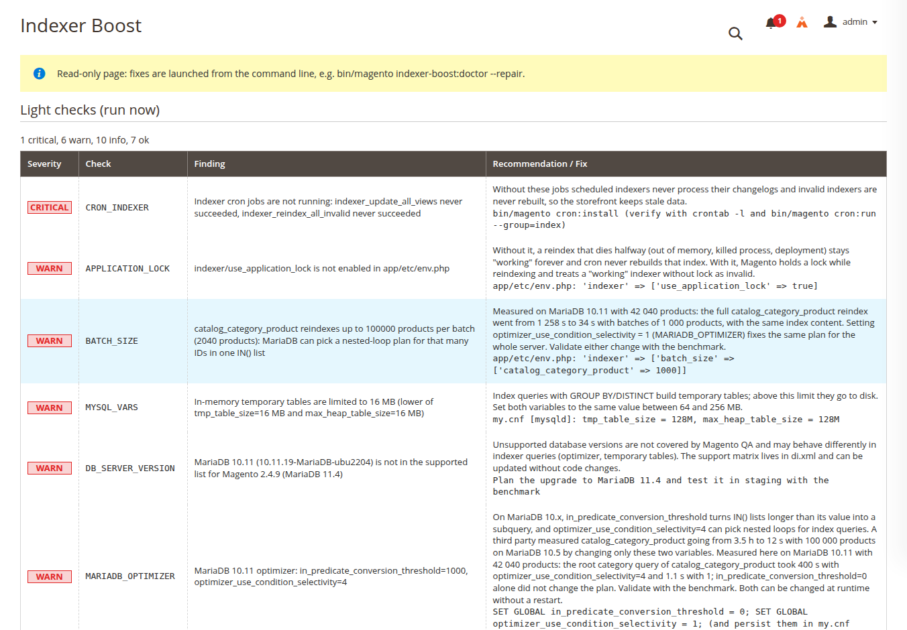
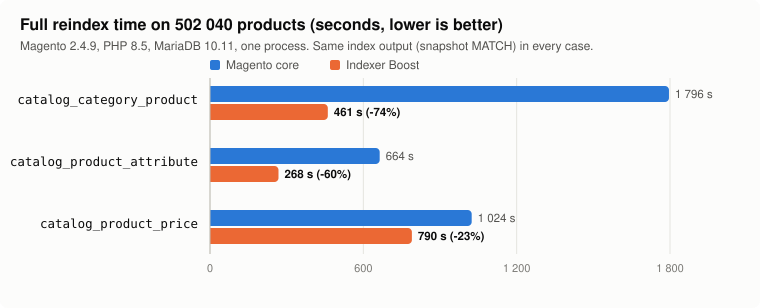
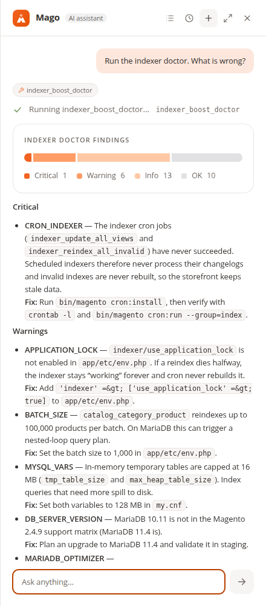

# Indexer Boost — overview

Magento keeps its storefront fast by precomputing data into index tables: which products belong to which category,
the final price per customer group and website, the attribute values used by layered navigation, search documents
and more. Rebuilding those indexes is one of the most common sources of trouble in a Magento store:

- full reindexes that take hours on a large catalog and block the next ones;
- indexers stuck in `working` after a process died, so the index is never rebuilt again;
- imports and API bursts that make indexers run one after another, or at the same time;
- database settings that make the index queries choose very slow plans;
- no history: nobody knows whether last night's reindex was slower than usual.

Indexer Boost addresses these in three layers, all without third-party code.

## 1. Diagnose: the doctor

`bin/magento indexer-boost:doctor` runs 26 read-only checks and prints each finding with its severity, the measured
values, why it matters and how to fix it. It covers:

- **Indexer state:** realtime ("Update on Save") indexers and what an import does to each of them, invalid,
  suspended and stuck indexers, the application lock.
- **Cron and backlog:** whether the index cron jobs run and keep up, changelog backlog, repeated or overlapping full
  reindexes.
- **Configuration:** batch sizes, parallel threads, price dimensions, catalog rule schedule, unused data exporters.
- **Database server:** buffer pool, temporary table limits, redo log, server version, MariaDB optimizer settings,
  table statistics.
- **Data:** catalog size, customer group × website combinations, catalog rule complexity, attribute flags nobody
  uses, redundant and orphan EAV values.
- **History:** reindexes that suddenly got slower than their usual duration.
- **Indexer Boost itself:** which rewrites are on and whether another module hooks into the same classes.

The doctor never changes anything. `--repair` is a separate, explicit step that only releases stuck indexers and
reindexes invalid ones; it never touches configuration.

## 2. Watch: the passive monitor

Every real full reindex and every changelog run of 1 s or more is recorded with its duration and error, in
production. Recording never interferes with the reindex: a failure to save is logged and dropped. The doctor uses this history to flag regressions and indexing that piles up, and
the admin page (*System > Tools > Indexer Boost*) shows the last and usual duration of every indexer.

## 3. Speed up: rewritten full reindexes

Three core full reindexes are rewritten. Each rewrite is off by default, switched on per indexer at run time, and
produces exactly the same index rows as the core (verified table by table with a canonical checksum):

| Indexer | Core | Indexer Boost | Why the core is slow |
|---|---:|---:|---|
| `catalog_category_product` | 1 796 s | 461 s (−74 %) | its work table is emptied with `DELETE` before every batch, and store values are resolved again in every batch |
| `catalog_product_attribute` | 664 s | 268 s (−60 %) | `LIMIT … OFFSET` batches and a work table that is never truncated: both grow with the square of the batch count |
| `catalog_product_price` | 1 024 s (median) | 790 s (−23 %) | MariaDB reads customer groups first and looks every product value up once per group |

On a medium catalog (42 040 products) the `catalog_category_product` result is even more dramatic: 1 258 s → 15 s.
Most of that came from configuration, not code: the core default batch of 100 000 product IDs makes MariaDB 10.x pick
a nested-loop plan. The doctor (`BATCH_SIZE`, `MARIADB_OPTIMIZER`) now detects that on any store.

## Measure: the benchmark

`Orangecat_IndexerBench` is the tool that produced those numbers, for development and staging copies only. It runs
reindexes in series, stores their metrics with a fingerprint of the environment, compares a baseline with a candidate
and proves the output is identical with canonical snapshots of the index tables. On a development or staging store
the results can also be read and compared in the admin (*System > Tools > Indexer Benchmarks*). Any change to indexing — a Magento
upgrade, a MySQL setting, a third-party module — can be measured the same way.

## Ask: the Mago add-ons

With [Mago](https://askmago.com/), the admin assistant for Magento, administrators can ask in plain language:

- "Why is my reindex slow?" — the doctor findings, with the age of the last full CLI report.
- "What is the indexer status?" — mode, state, last and usual duration, and which indexers run Indexer Boost.
- "Turn on Indexer Boost for the price indexer" — behind Mago's confirmation card, quoting the compatibility check.
- On a staging copy: "Compare the core and Boost benchmarks of the price indexer".

## Principles

- **Read-only by default.** Checks get a database connection that rejects anything but reads; a test runs every check
  against a database and filesystem that record any write.
- **Same output or nothing.** A rewrite ships only when its index tables match the core byte for byte on a large
  generated catalog, also with 2 processes for the indexers the core can run in parallel.
- **Reversible.** Every rewrite is a run-time flag; turning it off brings the core code back on the next reindex,
  without recompiling. If building the category snapshots fails, that reindex falls back to the core.
- **No third-party code** in the production modules. The Mago add-ons are the only ones that depend on Mago.
- **Measured, not assumed.** Every claim in this documentation comes from a stored benchmark run in
  [`benchmarks/`](benchmarks/).

## Compatibility

Magento 2.4.6 – 2.4.9 and PHP 8.2 – 8.5 for `Orangecat_IndexerBoost` (tested on Magento Open Source 2.4.9); the Mago add-ons
need Magento 2.4.9 (or Mage-OS 3.0) and Mago 1.1. Benchmarks were run on Magento 2.4.9, PHP 8.5 and MariaDB 10.11.
Adobe Commerce content staging (`row_id`) is not covered by the rewrites' identity tests.

Next: the [user manual](user-manual.md).
