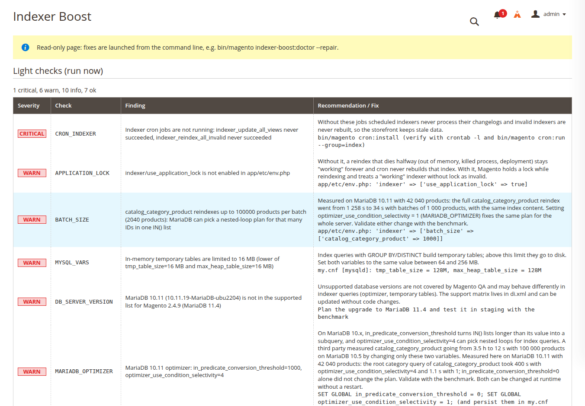
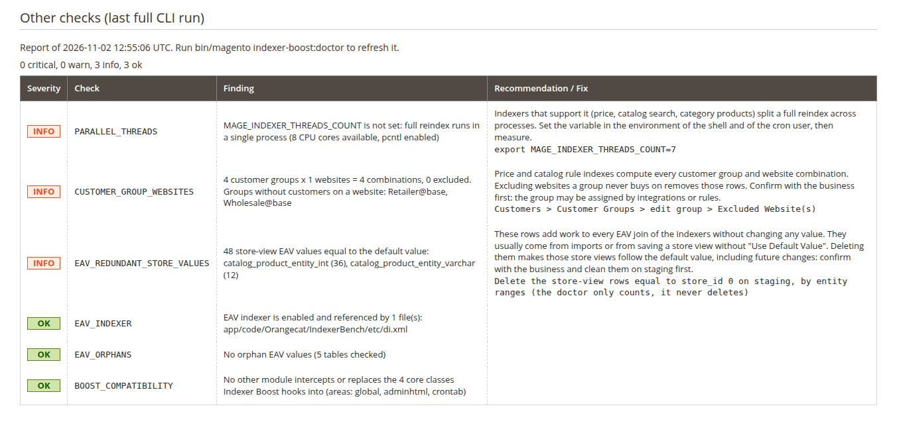
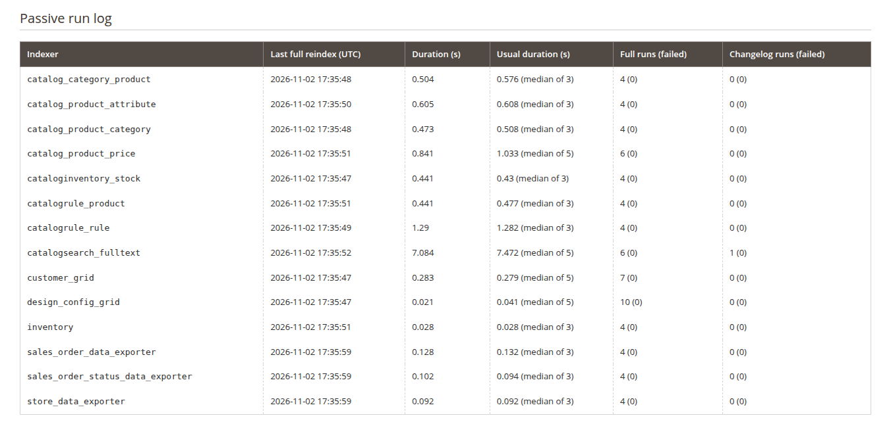
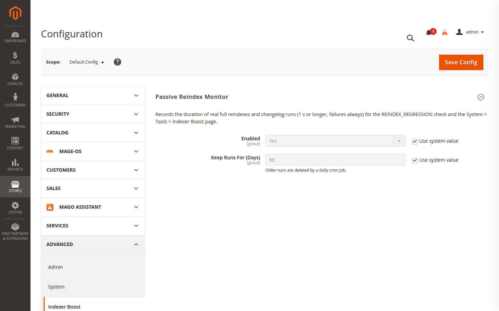
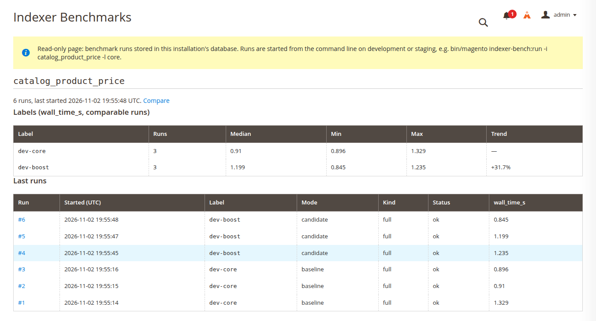
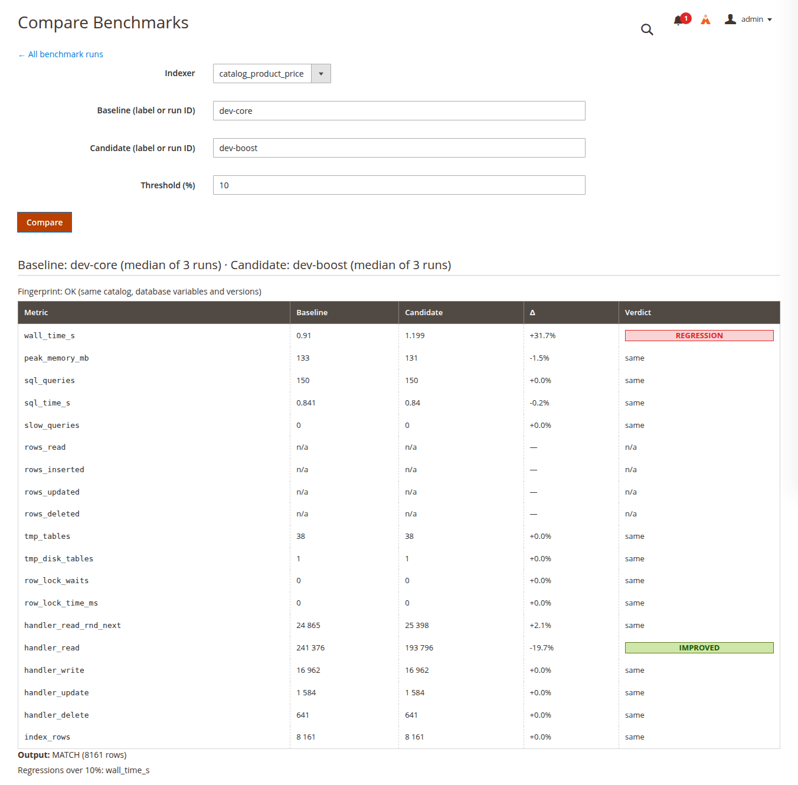
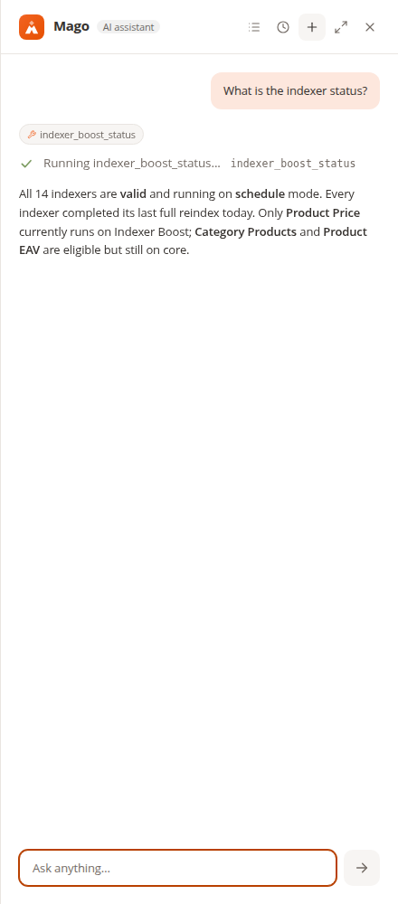
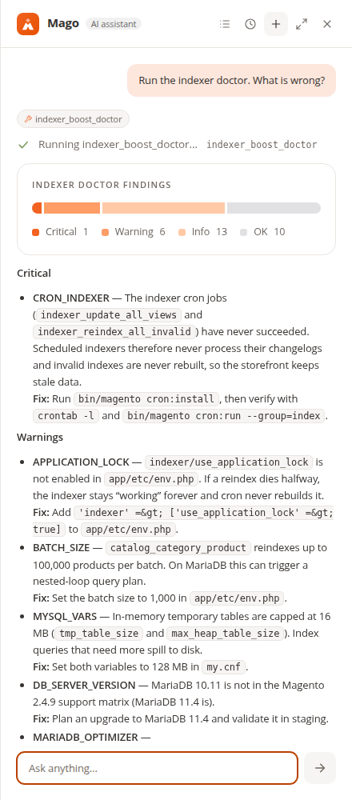
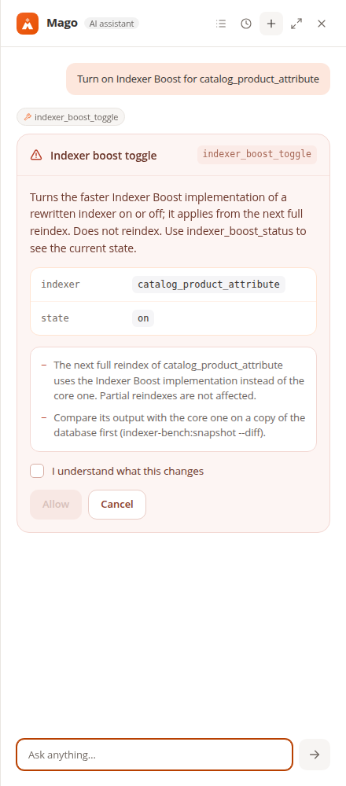

# Indexer Boost — user manual

This manual walks through day-to-day use: installing, diagnosing a store, fixing what the doctor finds, switching the
faster reindexes on, measuring on a staging copy and asking the Mago assistant. Every option is listed in the
[technical reference](technical-reference.md); how it works inside is in the [architecture](architecture.md).

Screenshots come from the development store (2 040 products), so its durations are sub-second.

**Contents**

1. [Installation](#1-installation)
2. [Your first diagnosis](#2-your-first-diagnosis)
3. [Fixing the usual findings](#3-fixing-the-usual-findings)
4. [Stuck and invalid indexers: `--repair`](#4-stuck-and-invalid-indexers---repair)
5. [The admin page](#5-the-admin-page)
6. [The passive monitor](#6-the-passive-monitor)
7. [Imports, APIs and indexing that piles up](#7-imports-apis-and-indexing-that-piles-up)
8. [Switching on the faster reindexes](#8-switching-on-the-faster-reindexes)
9. [Benchmarking on a staging copy](#9-benchmarking-on-a-staging-copy)
10. [Asking Mago](#10-asking-mago)
11. [Troubleshooting](#11-troubleshooting)

## 1. Installation

Production store:

```bash
bin/magento module:enable Orangecat_IndexerBoost
bin/magento setup:upgrade
```

The module creates one table (`orangecat_indexer_boost_run_log`) and one daily cron job. It changes no indexing
behaviour until you switch a rewrite on.

Development and staging only — the benchmark must never be installed on production (as a `require-dev`
dependency, for instance):

```bash
bin/magento module:enable Orangecat_IndexerBench
bin/magento setup:upgrade
```

With [Mago](https://askmago.com/) 1.1 installed (Magento 2.4.9 or Mage-OS 3.0):

```bash
bin/magento module:enable Orangecat_IndexerBoostMago          # production
bin/magento module:enable Orangecat_IndexerBenchMago          # staging, next to the benchmark
bin/magento setup:upgrade
bin/magento setup:static-content:deploy -f --area adminhtml en_US   # your admin locales
```

Mago adds its styles to the admin stylesheet, so the admin static content has to be deployed again, or its panel
shows unstyled.

## 2. Your first diagnosis

```bash
bin/magento indexer-boost:doctor
```

The doctor prints one row per finding, worst first, then a summary:

```
+----------+------------------+--------------------------------------------------------------+--------------------------------------------------------------+
| Severity | Code             | Message                                                      | Recommendation / Fix                                         |
+----------+------------------+--------------------------------------------------------------+--------------------------------------------------------------+
| CRITICAL | CRON_INDEXER     | Indexer cron jobs are not running: indexer_update_all_views  | Without these jobs scheduled indexers never process their    |
|          |                  | never succeeded, indexer_reindex_all_invalid never succeeded | changelogs and invalid indexers are never rebuilt, so the    |
|          |                  |                                                              | storefront keeps stale data.                                 |
|          |                  |                                                              | bin/magento cron:install (verify with crontab -l and         |
|          |                  |                                                              | bin/magento cron:run --group=index)                          |
| WARN     | APPLICATION_LOCK | indexer/use_application_lock is not enabled in               | Without it, a reindex that dies halfway (out of memory,      |
|          |                  | app/etc/env.php                                              | killed process, deployment) stays "working" forever and cron |
|          |                  |                                                              | never rebuilds that index. [...]                             |
|          |                  |                                                              | app/etc/env.php: 'indexer' => ['use_application_lock' =>     |
|          |                  |                                                              | true]                                                        |
| OK       | INDEXER_MODE     | All indexers are in "Update by Schedule" mode                |                                                              |
+----------+------------------+--------------------------------------------------------------+--------------------------------------------------------------+
Summary: 1 critical, 1 warn, 0 info, 1 ok
```

Each finding has:

- a **severity**: `critical` (the store serves wrong or stale data, or will), `warn` (indexing is slower or riskier
  than it needs to be), `info` (context or an optional improvement), `ok`;
- a **code** you can pass to `--only` and look up in the [technical reference](technical-reference.md#checks);
- the **message** with the measured values;
- the **recommendation** (why it matters) and the **fix** (a command, a configuration line or a place in the admin).

Useful options:

```bash
bin/magento indexer-boost:doctor --only=MYSQL_VARS,BATCH_SIZE      # some checks only
bin/magento indexer-boost:doctor --format=markdown --output=doctor.md   # for a ticket
bin/magento indexer-boost:doctor --format=json                      # for CI and tooling
```

The exit code is `1` when a `critical` finding exists, so the doctor can gate a deployment pipeline.

**Run the full doctor once after installing, and again after big changes.** Some checks scan the EAV tables or the
code base and take longer; they run only from the command line, and the admin page and Mago show their results from
the last full run.

The doctor is read-only: it never changes data, configuration or indexes. Applying a fix is always your decision.

## 3. Fixing the usual findings

Findings seen on most stores, in the order worth fixing them:

| Finding | What to do |
|---|---|
| `CRON_INDEXER` critical | The index cron does not run. `bin/magento cron:install`, then check `crontab -l` and `bin/magento cron:run --group=index`. Nothing else matters until this works. |
| `INDEXER_STUCK` critical | An indexer died halfway and stays `working`. See [`--repair`](#4-stuck-and-invalid-indexers---repair). |
| `INDEXER_MODE` warn | Indexers in "Update on Save" reindex inside every save, import batch and API call. `bin/magento indexer:set-mode schedule <ids>` (the fix line lists them). |
| `APPLICATION_LOCK` warn | Add `'indexer' => ['use_application_lock' => true]` to `app/etc/env.php`, so a dead reindex is detected as invalid and rebuilt. |
| `BATCH_SIZE` warn (MariaDB) | Set `catalog_category_product` batches to 1 000 in `app/etc/env.php`: `'indexer' => ['batch_size' => ['catalog_category_product' => 1000]]`. On a 42 040-product catalog this alone took the full reindex from 1 258 s to 34 s. |
| `MARIADB_OPTIMIZER` warn | `SET GLOBAL optimizer_use_condition_selectivity = 1` and persist it in `my.cnf`; validate with the benchmark first. |
| `MYSQL_VARS` critical/warn | Database memory: buffer pool sized to the data, in-memory temporary tables of 64–256 MB. Values are in the fix line. |
| `MVIEW_BACKLOG`, `REINDEX_CHURN` warn | Indexing does not keep up. See [section 7](#7-imports-apis-and-indexing-that-piles-up). |

Data findings (`EAV_REDUNDANT_STORE_VALUES`, `EAV_ORPHANS`, `ATTRIBUTE_FLAGS`, `CUSTOMER_GROUP_WEBSITES`) are
reported for a business decision: the doctor only counts, and cleaning should be agreed and tried on staging first.

## 4. Stuck and invalid indexers: `--repair`

```bash
bin/magento indexer-boost:doctor --repair
```

After printing the report, `--repair` does two things and nothing else:

1. **Releases stuck indexers.** For every indexer `INDEXER_STUCK` reports as stuck (status `working`, no lock held,
   no write running on its tables), it asks `[y/N]` and marks it invalid. Doubtful cases (the database user lacks the
   `PROCESS` privilege) are asked too; indexers that are still writing are never touched. With `-n` stuck indexers
   are released and doubtful ones skipped.
2. **Reindexes every invalid indexer**, dependencies first, timing each one.

It never changes configuration. On a large catalog the reindexes can take hours: run it in a maintenance window.

## 5. The admin page

*System > Tools > Indexer Boost* (ACL *System > Tools > Indexer Boost*). The page is read-only.

**Light checks** run on every page load:



**Other checks** are the heavy ones, read from the last full `bin/magento indexer-boost:doctor` run, with its date.
Without that report the page asks you to run the command:



**Passive run log** lists every indexer with its last successful full reindex, its usual duration (median of the
previous ones) and the number of full and changelog runs, failures in brackets:



## 6. The passive monitor

The monitor records every real full reindex and every changelog run of 1 s or more (failures always), with its
duration and error. It is on by default. Configure it in *Stores > Configuration > Advanced > Indexer Boost*:



- **Enabled** — turn recording off and on.
- **Keep Runs For (Days)** — 90 by default; older runs are deleted every night at 03:30 by the
  `orangecat_indexer_boost_run_log_cleanup` cron job.

After about six full reindexes of an indexer, `REINDEX_REGRESSION` starts warning when the last one took more than
twice the usual time (and more than 60 s). That usually points to something that changed before that run: an import,
new catalog rules, a website or customer group, database settings or custom code.

## 7. Imports, APIs and indexing that piles up

A common complaint: after a CSV import or a burst of API calls, indexers run one after another for a long time, or
several run at the same time. Two checks explain why on your store.

**`INDEXER_MODE`** — with indexers in "Update on Save", the core product import:

- reindexes `catalog_product_category`, `catalog_product_price` and `cataloginventory_stock` synchronously for every
  batch of rows, so the import itself gets slow;
- invalidates `catalog_product_attribute`, `catalogrule_rule` (and `catalog_product_flat`, `customer_grid` for their
  imports) when it finishes, so cron then runs their **full** reindexes one after another;
- does not refresh the other realtime indexers at all, `catalogsearch_fulltext` for example: they keep stale data
  until their next full reindex.

The fix is the same in every case: put every indexer on "Update by Schedule". Changes are then captured by database
triggers and applied by cron in small partial reindexes.

**`REINDEX_CHURN`** looks at the last 24 hours and warns about:

- an indexer with 3 or more full reindexes — usually invalidations from imports in realtime mode, attribute, website,
  customer group or catalog rule changes, or scripts calling `indexer:reindex`;
- full reindexes that ran at the same time — usually `indexer:reindex` launched by hand or by a script while cron was
  reindexing. Leave full reindexes to cron, or pause cron first;
- index cron jobs that were missed, failed or ran longer than their one-minute interval — the changelog grows and
  every indexer behind the slow one waits. Speed up the slowest indexer (see `REINDEX_REGRESSION`, `MVIEW_BACKLOG`,
  `BATCH_SIZE`) and run large imports off-peak.

## 8. Switching on the faster reindexes

Three full reindexes have an Indexer Boost implementation: `catalog_category_product` (also used by
`catalog_product_category`), `catalog_product_attribute` and `catalog_product_price`. Each one is off until you
switch it on, and switching takes effect on the next full reindex, without recompiling.

Recommended procedure, per indexer:

1. **Check compatibility.** Run the full doctor and read `BOOST_COMPATIBILITY`: it lists other modules with plugins
   or preferences on the classes the rewrites hook into. A module there was never tested with the rewrite.
2. **Compare on a staging copy** ([section 9](#9-benchmarking-on-a-staging-copy)): the index output must be
   `MATCH`.
3. **Switch it on in production:**

   ```bash
   bin/magento indexer-boost:toggle catalog_product_price on
   ```

4. **Let the next full reindex run** (cron after an invalidation, or `bin/magento indexer:reindex
   catalog_product_price`) and watch its duration on the admin page.
5. **Switch it off** the same way if anything looks wrong:

   ```bash
   bin/magento indexer-boost:toggle catalog_product_price off
   ```

Partial (changelog) reindexes always use the core code. `BOOST_STATUS` in the doctor and the admin page say which
implementation each indexer uses. If building its per-store snapshots fails, the `catalog_category_product` rewrite
logs the error and runs the core reindex instead (`fallback_on_error`, on by default).

On MariaDB, also keep `catalog_category_product` batches at 1 000 (`BATCH_SIZE`): with the rewrite on, small batches
are no longer slow.

## 9. Benchmarking on a staging copy

**Never benchmark on production or on the database your team works with**: every run invalidates and rebuilds
indexes. `bin/bench-magento` runs `bin/magento` against a copy of the database with its own cache:

```bash
# once: clone the database and keep its search index apart
mariadb -e 'CREATE DATABASE magento_bench; GRANT ALL ON magento_bench.* TO magento@"%"'
mariadb-dump --single-transaction --routines --triggers magento | mariadb magento_bench
mariadb magento_bench -e "UPDATE core_config_data SET value = 'magento2_bench'
    WHERE path = 'catalog/search/opensearch_index_prefix'"

B=app/code/Orangecat/IndexerBench/bin/bench-magento
$B config:show catalog/search/opensearch_index_prefix     # must print magento2_bench
$B indexer:reindex                                         # start from empty changelogs
```

Then measure the core, switch the rewrite on in the copy, and measure again:

```bash
$B indexer-bench:run -i catalog_product_price -l core --repeat=3 --warmup
$B indexer-bench:snapshot -i catalog_product_price -l core

$B indexer-boost:toggle catalog_product_price on
$B cache:flush
$B indexer-bench:run -i catalog_product_price -l boost --repeat=3 --warmup
$B indexer-bench:snapshot -i catalog_product_price -l boost --diff=core   # MATCH or DIFFER

$B indexer-bench:compare -i catalog_product_price --baseline=core --candidate=boost
```

`compare` prints every metric with its change and verdict, warns when the two environments differ (catalog,
database variables, versions, threads) and ends with the output verdict:

```
| Metric      | Baseline | Candidate | Δ      | Verdict     |
| wall_time_s | 41.7     | 35.9      | -13.9% | ✅ improved |
Output: MATCH (488 163 rows)
```

### In the admin

Where the benchmark module is installed, *System > Tools > Indexer Benchmarks* shows the runs stored in **that
installation's database**: run `bin/magento indexer-bench:run` on a development or staging store and its results
appear there (runs made with `bin/bench-magento` live in the copy it points at). The page only reads; runs are always
started from the command line, and the benchmark refuses to run in production mode.



Open a run for its metrics, environment and error, or download its Markdown report. *Compare* takes two labels or
run IDs and shows the same verdicts as `indexer-bench:compare`:



The screenshots come from the 2 040-product development store, where a price reindex takes under a second: the
"regression" on `wall_time_s` there is run-to-run noise. Measure speed on a large catalog.

A run invalidates the measured indexer and, through the core, the indexers that depend on it (for instance
`catalogsearch_fulltext` after `catalog_product_price`). Cron rebuilds them, or run `bin/magento indexer:reindex`.

More commands:

- `indexer-bench:run-partial -c 500 --seed=42` — a partial reindex of the same 500 products on every run.
- `indexer-bench:history -i <indexer>` — the runs and the median of each label, with its trend.
- `indexer-bench:export --format=markdown --output=docs/benchmarks/<file>.md` — a report ready to share.
- `--profile` on `run` — a Magento profiler report per run, with `mage-os/module-profiler` installed.

Measure without traffic and without cron on that database server: server counters include every connection. In
production mode the benchmark refuses to run unless the host and database are listed in `indexer_bench/allowed_hosts`
in `app/etc/env.php`.

## 10. Asking Mago

With the Mago add-ons installed, open the assistant from the admin header and ask in your own words, in any language
the configured model speaks. The tools need the *System > Tools > Indexer Boost* ACL resource; switching also needs *Switch Indexer Boost
Implementations*, and the benchmark tools *View Indexer Benchmarks*.

**Status** — "What is the indexer status?":



**Diagnosis** — "Why is my reindex slow?" or "Run the indexer doctor. What is wrong?". Mago runs the light checks
now, adds the heavy ones from the last CLI report (and says how old it is), and lists every critical and warn finding
with its fix:



**Switching** — "Turn on Indexer Boost for catalog_product_attribute". Nothing changes until an administrator ticks
*I understand what this changes* and clicks *Allow*. The card says what changes and, when the last doctor report
found other modules on the same classes, quotes that finding:



The slash command `/boost status|doctor|on <indexer>|off <indexer>` does the same without a question.

On staging, with `Orangecat_IndexerBenchMago`: "Show the benchmark history of catalog_category_product", "Compare
core with boost for the price indexer", "Show the report of the last benchmark run".

What Mago cannot do, on purpose: run `--repair`, the heavy checks or a benchmark. They take minutes or hours and a
Mago tool runs inside the chat request. Mago names the command for someone with server access instead.

Providers: answers depend on the model. The add-ons were tested with Kimi (`kimi-2.6`) through Mago's
OpenAI-compatible provider, which needs `symfony/ai-generic-platform`; its Base URL has no `/v1`.

## 11. Troubleshooting

| Symptom | Cause and fix |
|---|---|
| `indexer-boost:toggle` says the indexer has no Indexer Boost implementation | Only the three rewritten indexers can be switched. Right after deploying a new version, `bin/magento cache:flush`. |
| The admin page shows no heavy checks | Run `bin/magento indexer-boost:doctor` once from the command line (without `--only`). |
| `REINDEX_REGRESSION` says "Not enough history yet" | It needs 6 successful full reindexes per indexer in the run log. |
| Mago's panel has no styles | Deploy the admin static content again (section 1). |
| Mago answers the status without mentioning Indexer Boost | The model used a generic indexer tool. Ask about "Indexer Boost" explicitly, or use `/boost status`. |
| Parallel reindex fails with "protocol error" or "Fail in child process" | A core limitation with a Redis/Valkey cache shared by the forked processes, with or without Indexer Boost. |
| A benchmark run is refused | It is in production mode outside `indexer_bench/allowed_hosts`, or the indexer is already `working`. |
| *Indexer Benchmarks* is empty | The runs were stored in another database (for example the copy `bin/bench-magento` uses). |
| "One or more indexers are invalid" after a benchmark | Indexers that depend on the measured one were invalidated by its reset; cron or `indexer:reindex` rebuilds them. |
